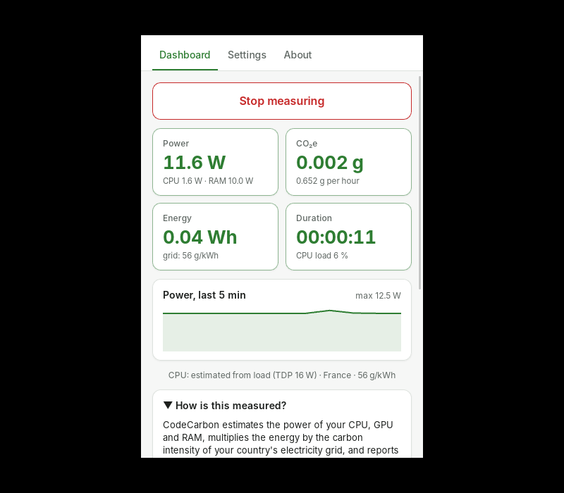
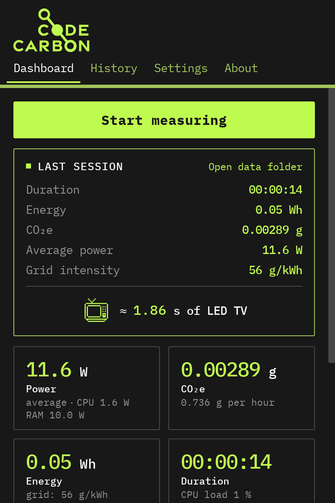

# CodeCarbon Desktop

A tiny tray / menu-bar application that measures the power draw and CO₂
emissions of your computer with [CodeCarbon](https://github.com/mlco2/codecarbon),
for people who do not want to open a terminal.

* **Install** with a double-click (Windows `.exe`, macOS `.dmg`, Linux `.AppImage` / `.deb` / `.rpm`).
* **Start / Stop** measuring from the tray icon.
* **See** live power (W), energy (Wh) and CO₂e (g), plus a summary of each session.
* **Keep** a history in a CSV file written by CodeCarbon itself.
* Later: log in to the CodeCarbon API and upload your sessions (see the [roadmap](docs/ROADMAP.md)).

  
  

## Install

Download the installer for your system from the
[Releases](https://github.com/mlco2/codecarbon-gui/releases) page (or the
*Artifacts* of the latest [CI run](https://github.com/mlco2/codecarbon-gui/actions)
for development builds) and follow **[docs/INSTALL.md](docs/INSTALL.md)**: it
covers the one-time security warning each OS shows for unsigned apps.

| System | File |
| --- | --- |
| Windows 10/11 (x64) | `CodeCarbon_<version>_x64-setup.exe` (or `.msi`) |
| macOS Apple Silicon | `CodeCarbon_<version>_aarch64.dmg` |
| macOS Intel | `CodeCarbon_<version>_x64.dmg` |
| Linux | `CodeCarbon_<version>_amd64.AppImage`, `.deb` or `.rpm` |

## How it works

The app is a small [Tauri 2](https://tauri.app) (Rust) shell that bundles a
frozen Python program, `codecarbon-agent`, which drives the real CodeCarbon
library. The numbers you see are exactly the ones the Python package computes.
Read [docs/DESIGN.md](docs/DESIGN.md) for the architecture and the reasoning,
and [docs/PROTOCOL.md](docs/PROTOCOL.md) for the way the two halves talk.

## Developing

See [docs/DEVELOPMENT.md](docs/DEVELOPMENT.md). In short: `pip install -e "agent[dev]"`,
`npm install`, `python agent/build.py`, `npm run tauri dev`.

## Status

v0.1: measures and displays; installers for the three platforms are built by
CI. Next: CodeCarbon API login and upload, history, auto-update — see
[docs/ROADMAP.md](docs/ROADMAP.md).

## Security

No telemetry, no admin rights, network only when you ask for it. Dependencies
are audited and scanned by CodeQL on every change, and every release ships
checksums and build-provenance attestations. Details in [SECURITY.md](SECURITY.md).

## Licence

MIT — see [LICENSE](LICENSE).
